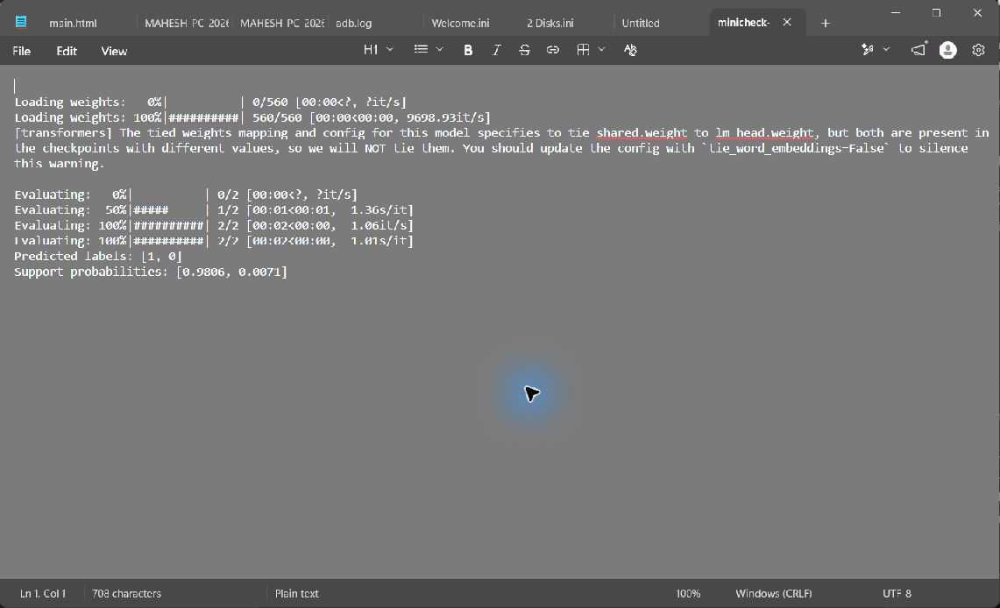

# MiniCheck: Efficient Fact-Checking of LLMs on Grounding Documents

Assessment 2 project based on the [MiniCheck repository](https://github.com/Liyan06/MiniCheck).

## Run the demo (Windows)

```powershell
py -3.11 -m venv .venv
.\.venv\Scripts\Activate.ps1
python -m pip install --upgrade pip
python -m pip install -e .
python run_demo.py
```

The first run downloads the Flan-T5 MiniCheck model from Hugging Face. The checkpoint is about 3.13 GB, so make sure you have enough free disk space. The downloaded model files stay in the ignored `ckpts/` directory and are not committed to GitHub.

To use a checkpoint already downloaded into `./ckpts/manual-model`, set the local path first:

```powershell
$env:MINICHECK_FLAN_T5_PATH = ".\ckpts\manual-model"
python run_demo.py
```

## Successful execution

The demo checked one supported and one unsupported claim against the grounding document. It completed successfully and returned:

```text
Predicted labels: [1, 0]
Support probabilities: [0.9806, 0.0071]
```


